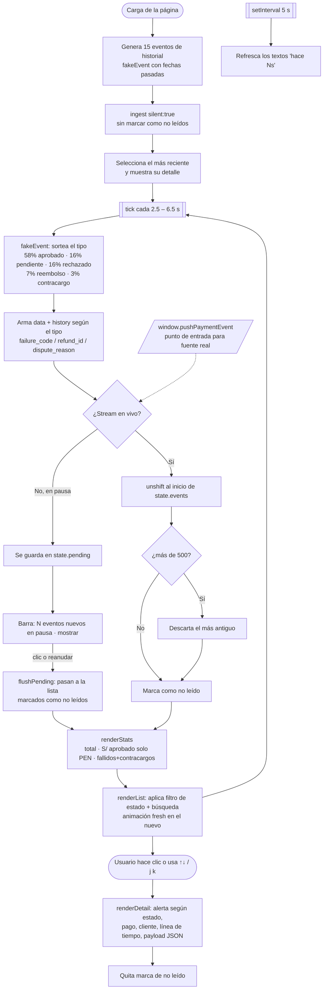
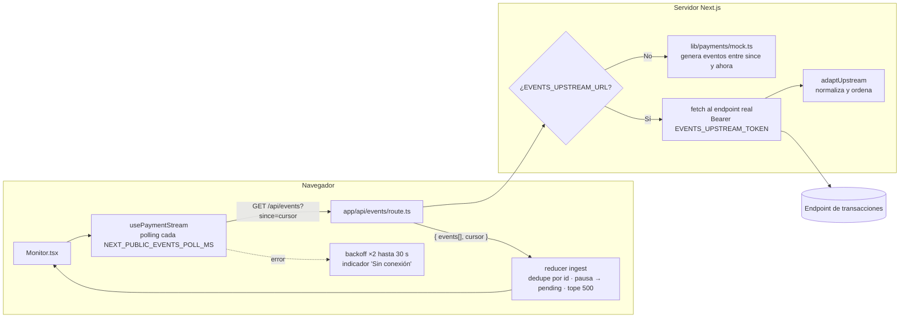
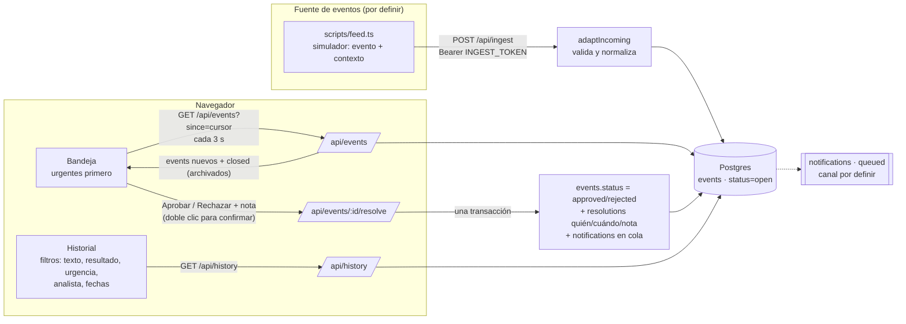

# Flujo de reporte de transacciones como eventos

## 1. Cómo funciona hoy (prototipo `Monitor de Pagos.html`)

Todo ocurre en el navegador. No hay backend: un simulador inventa eventos y los mete en memoria.



**Puntos clave del flujo actual**

| Etapa | Qué pasa | Limitación |
|---|---|---|
| Origen | `fakeEvent()` en el navegador | Datos ficticios, nada persiste |
| Ingesta | `ingest()` decide lista o `pending` según pausa | No deduplica: si llega el mismo evento dos veces, aparece dos veces |
| Almacenamiento | Arreglo en memoria, tope 500 | Al recargar se pierde todo |
| Estadísticas | Se calculan sobre lo que hay en memoria | "Aprobado" ignora USD; solo cuenta lo visible en la sesión |
| Detalle | Se re-renderiza todo el HTML con `innerHTML` | — |

## 2. Cómo queda en Next.js (este repo)

El navegador ya no genera nada: pregunta cada 3 s a `/api/events` por los eventos posteriores al último cursor.
La ruta decide si usa el simulador o el endpoint real, así que el cambio a producción es solo configurar variables de entorno.



### Contrato esperado del endpoint

```
GET <EVENTS_UPSTREAM_URL>?since=<cursor>&limit=<n>

200 OK
{
  "events": [ PaymentEvent, ... ],   // del más antiguo al más nuevo
  "cursor": "..."                    // se envía como `since` en la siguiente llamada
}
```

- Sin `since` → devolver el historial reciente (la primera carga).
- `PaymentEvent` está definido en `src/lib/payments/types.ts`.
- Si el endpoint real usa otro formato (otros nombres de campo, montos en soles en vez de céntimos, paginación distinta), solo hay que cambiar `adaptUpstream()`.

## 3. Flujo actual: casos con decisión del analista (Postgres)

El navegador ya no recibe eventos sueltos sino **casos**: cada evento llega con su contexto, queda abierto hasta que un analista lo decide, y luego se archiva.



- Si dos analistas deciden el mismo caso, el segundo recibe 409 («Diego Ramos ya lo rechazó») y el caso sale de su bandeja.
- Cuando cualquier analista archiva un caso, desaparece de la bandeja de todos en el siguiente polling (`closed`).
- Las notificaciones quedan en `notifications` con `status = queued`; falta definir el canal y el proceso que las envíe.
